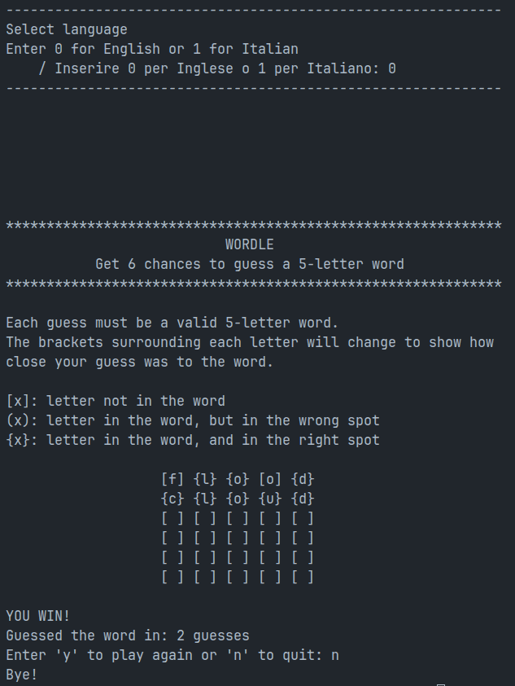

# Wordle CLI

A terminal-based recreation of Wordle\superscript{\®} written in C++, playable in both English and Italian.

Unlike the original game, this version uses different types of brackets instead of colors to indicate the accuracy of each guess.

## Screenshots



## Features

- Fully bilingual interface (English and Italian).
- Built-in dictionary of 2,315 English words. (from github.com/Kinkelin/WordleCompetition)
- Built-in dictionary of 1,524 Italian words. (from github.com/pietroppeter/wordle-it)
- Random word selection at the beginning of each game.
- Six attempts to guess the secret word.
- Interactive terminal-based game board.
- Word length and dictionary validation.
- Replay functionality without restarting the program.
- No external libraries or dictionary files required.

## How to play

At startup, select your preferred language:

- `0` — English
- `1` — Italian

Enter a valid five-letter word in lowercase. You have six attempts to guess the secret word.

After each guess, the brackets surrounding each letter indicate its accuracy:

| Symbol | Meaning |
|---|---|
| `[x]` | Letter not present in the secret word |
| `(x)` | Correct letter in the wrong position |
| `{x}` | Correct letter in the correct position |

Invalid guesses do not count towards the six available attempts.

If you fail to guess the word, the solution is revealed at the end of the game.

## Requirements

- A C++11 or newer compatible compiler.
- A terminal supporting ANSI escape sequences for cursor movement and screen clearing.

## Compilation

Compile the source code using g++:

```
g++ -std=c++17 wordle.cpp -o wordle
```

## Running the game

On Linux and macOS:

```
./wordle
```

On Windows (PowerShell):

```
.\wordle.exe
```

## Dictionary Sources

The word lists used in this project were obtained from the following repositories:

- English dictionary (2,315 words): "WordleCompetition" (github.com/Kinkelin/WordleCompetition)
- Italian dictionary (1,524 words): "wordle-it" (github.com/pietroppeter/wordle-it)

Both dictionaries are embedded directly in the source code.

Credit for the original word lists goes to their respective authors and contributors.

## Implementation

The project makes use of:

- Arrays and character strings
- Dynamic memory allocation
- Functions
- Standard C++ strings
- Pseudorandom number generation using `std::mt19937`
- ANSI escape sequences for terminal manipulation

## Disclaimer

This is an unofficial recreation of Wordle made as a personal programming project. It is not affiliated with the original game or The New York Times.
